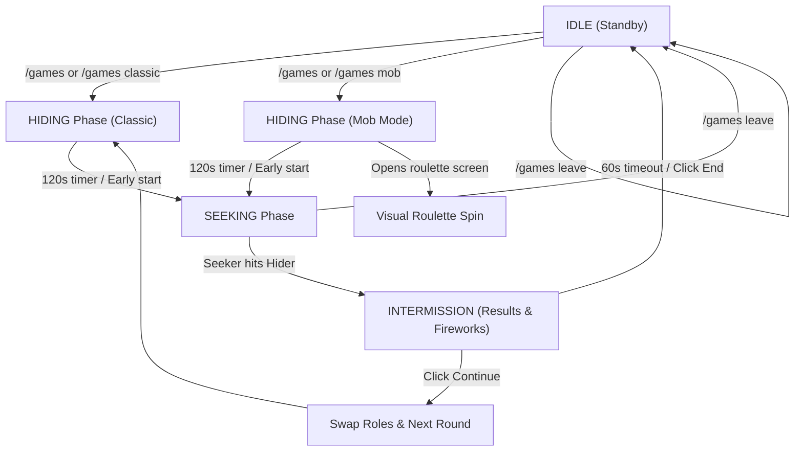

# Feature Specification: Hide & Seek with Mob Disguise & Visual Roulette

## 1. Overview
Hide & Seek is an interactive duel mini-game built for the FoMe survival server on Fabric (Minecraft 1.21.1) in **Kotlin**.
It features a state machine, voting, custom phase timers, complete damage immunity during the event, a landmark proximity hint system, an in-game animated visual roulette wheel (`RouletteScreen`), and a Mob Disguise mode with dynamic hitbox scaling (`Attributes.SCALE`) and camera height adjustment.

---

## 2. Core Game Loop & State Machine

### Phase Details:
1. **`IDLE`**: No game active. Scoreboard clean.
2. **Instant Start (`VOTING`/`IDLE`)**: Initiated via `/games`. Interactive chat buttons `[ Классика ]` (`/games classic`) and `[ Маскировка мобом ]` (`/games mob`). If 2 or more players are online, choosing a mode starts the game **immediately** without waiting for a second vote.
3. **`HIDING`** (120 seconds):
   - **Elytra**: Allowed for the Hider to reach high/distant spots.
   - **Action Bar**: Displays real-time countdown timer.
   - **Audio Cue**: Last 10 seconds feature a ticking note block countdown with rising pitch (0.6 -> 1.86).
   - **Early Start**: `[ ▶ Начать поиск раньше ]` (`/games startsearch`) button in chat allows ending prep early.
   - **Cancel Game**: `[ ✖ Закончить игру ]` (`/games leave`) aborts the round and resets to idle.
   - **Mob Mode**: Hider triggers/receives visual roulette spin (`RouletteScreen`), receives native mob disguise via packet interception, and scaled hitbox.
4. **`SEEKING`** (Hunting phase):
   - **Start Fanfare**: Raid horn sound (`RAID_HORN`), title `ОХОТА НАЧАЛАСЬ!` and emergency hint button to seeker.
   - **Elytra Invariant**: Hider is strictly forbidden from using Elytra (`stopFallFlying()`). Seeker is allowed to fly.
   - **Block Breaking**: Strictly cancelled for both players (`PlayerBlockBreakEvents.BEFORE`).
   - **Immortality**: Both players are immune to all damage (`ServerLivingEntityEvents.ALLOW_DAMAGE`).
   - **Hit Detection**: Seeker landing a hit on the Hider concludes the round (`AttackEntityCallback`).
   - **20-Block Warning**: If Hider strays >20 blocks from their hiding spot, a chat alert is broadcast.
   - **Multi-Tier Hints**:
     - *Distance hint (every 3 minutes)*: Discrete tiers 1, 5, 10, 15, 20, 25, 30, 35, 40, 45, 50, +5 blocks. Dimension-aware.
     - *Emergency hint (`/games hint`)*: 1 per 5 minutes for seeker (non-repeating trait clues).
     - *Acoustic taunt (every 45 seconds)*: Disguised mob ambient sound audible within 35-40 blocks.
     - *Categorical hint (every 90 seconds)*: Trait clue broadcast to chat.
     - *Landmark proximity (every 50 seconds)*: Nearest registered build.
5. **`INTERMISSION`** (60 seconds auto-reset):
   - Large on-screen title `ПОЙМАН!` with elapsed time (`mm:ss`) and next seeker name.
   - Celebration fireworks over seeker, level-up and challenge complete sound effects.
   - Disguise cleared and true identity revealed.
   - Interactive buttons: `[ ▶ Следующий раунд ]` (swaps roles and restarts) or `[ ✖ Выйти из игры ]`.

---

## 3. Sub-Modes
1. **Classic Mode**: Standard player models, no disguises.
2. **Mob Disguise Mode (All Minecraft 1.21.1 Living Entities)**:
   - **Expanded Mob Pool**: Includes **all living entities** in Minecraft (70+ mobs), from tiny creatures (Silverfish, Bee, Frog, Axolotl) to giants (Warden, Iron Golem, Ravager, and Bosses).
   - **Dynamic Scaling via `Attributes.SCALE`**: Scales the player's bounding box and model proportionally to the disguised mob's dimensions.
   - **Environmental Immunity Safeguards**:
     - Aquatic mobs (Axolotl, Dolphin, Squid, Fish) are granted permanent water-breathing and dehydration immunity so they never suffocate on land.
     - Destructive mobs (Warden, Ender Dragon, Wither) have their block-destruction behaviors suppressed per `docs/gameplay-rules.md` (Zero Block Griefing invariant).
   - **Collision Guardrail & Anti-Stuck**: If large mobs clip or suffocate inside solid geometry, the automated anti-stuck relocator safely shifts them to the nearest air space.
   - **Client Camera**: Eye-height is dynamically synchronized to match the disguised entity's actual eye height.

---

## 4. Acoustic & Intellectual Hinting Engine (Seeking Phase)

To balance hiding as tiny, flying, or exotic mobs without spoiling the mystery, the server runs three complementary hint loops during the `SEEKING` phase:

### 4.1 Acoustic Sound Taunt (Every 45 seconds / 900 ticks)
- The hider involuntarily emits their disguised mob's authentic vanilla ambient sound (`ambientSound`).
- Audible to the seeker within a spherical radius of **35–40 blocks**, turning close-range hunting into an acoustic search.

### 4.2 Intellectual Categorical Hint (Every 1 minute 30 seconds / 1800 ticks)
- Broadcasts a categorical clue to chat (using strict i18n keys) without revealing the specific mob name:
  - **Size Class**:
    - *Tiny* (height < 0.8m): Silverfish, Endermite, Bee, Baby Turtle, Frog.
    - *Medium* (0.8m ≤ height ≤ 2.4m): Cow, Zombie, Skeleton, Creeper, Piglin.
    - *Colossal* (height > 2.4m): Warden, Iron Golem, Enderman, Ravager, Ghast.
  - **Habitat / Origin**:
    - *Nether Origin*: Ghast, Blaze, Piglin, Strider, Magma Cube, Wither Skeleton.
    - *Aquatic Entity*: Dolphin, Guardian, Squid, Drowned, Turtle, Fish.
    - *End Origin*: Enderman, Shulker, Endermite.
    - *Overworld Native*: Farm animals, standard monsters, villagers.
  - **Locomotion**:
    - *Aerial / Flying*: Bat, Bee, Phantom, Parrot, Blaze, Ghast.
    - *Terrestrial*: Standard ground walkers.
  - **Disposition**:
    - *Peaceful / Passive*: Farm animals, bats, allays.
    - *Hostile / Predator*: Monsters and bosses.

### 4.3 Periodic Distance Hint (Every 3 minutes / 3600 ticks)
- Broadcasts discrete 3D distance from seeker to hider:
  - Close proximity: `~1 block` (within 3 blocks).
  - Standard tiers: `~5`, `~10`, `~15`, `~20`, `~25`, `~30`, `~35`, `~40`, `~45`, `~50` blocks.
  - Long range: Increments of +5 blocks (`~55`, `~60`, `~65`, etc.).
  - Cross-dimension awareness: If seeker and hider are in different dimensions, alerts that the hider is in another dimension instead of displaying invalid coordinates.
  - Accompanied by subtle chime (`SoundEvents.EXPERIENCE_ORB_PICKUP`).

### 4.4 Seeker Emergency Hint (`/games hint`, 1 per 5 minutes)
- Available on demand to the seeker with a 300-second (5 min) cooldown.
- Non-repeating categorical clues.

### 4.5 Landmark Proximity Hints (Every 50 seconds / 1000 ticks)
- Broadcasts horizontal distance comparison: *"Out of all builds, the hider is closest to: <Landmark>"*.
- Alert on 20-block relocation: Triggered once if the hider strays >20 blocks from their hiding spot.

---

## 5. Visual Roulette Wheel (`RouletteScreen`)
- Client-side custom screen (`Screen`) opening during mob selection.
- 3D entity models rendered in cards with dynamic bounding box scaling (`18.0f / max(bbWidth, bbHeight)`).
- Spinning tape of mob icons with smooth easing (`easeOutCubic`).
- Audio feedback: tick clicks (`UI_BUTTON_CLICK`) on passing icons.
- Visual finish: stop animation, camera shake, particle flare, fanfare sound.

---

## 6. Landmark Proximity System
- Persistent storage: `config/exservermod/landmarks.json`.
- Commands:
  - `/location-add [radius] <name>` (radius defaults to 50, Y spans -64..1000).
  - `/location-remove <name>`
  - `/location-list`
- During seeking phase, computes 2D horizontal distance to all landmark cylinder perimeters.
- Outputs hint: *"Out of all builds, the hider is closest to: <Landmark>"*.

---

## 7. Commands Reference & Operational Guide
- `/games` — check status or show mode start buttons.
- `/games classic` / `/games mob` — start immediately in selected mode.
- `/games startsearch` — start hunting phase early.
- `/games hint` — request emergency hint (seeker only, 5 min cooldown).
- `/games continue` — advance to next round with swapped roles.
- `/games leave` — abort and reset game state.
- Full operational troubleshooting and invariants are documented in [docs/combat-rules-and-troubleshooting.md](file:///Users/soroqn/me/private-code/Minecraft-FoMe/ExServerMod/docs/combat-rules-and-troubleshooting.md).

---

## 8. BlueMap Integration & Stealth Invariant
- During `HIDING` and `SEEKING` phases:
  - Participants' map visibility is set to hidden via BlueMap API (`setPlayerVisibility(false)`).
  - Breadcrumb trails / markers are frozen/cleared.
- On `INTERMISSION` or game termination:
  - Map visibility is restored (`setPlayerVisibility(true)`).

